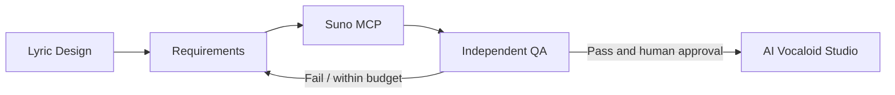

# SUNO-GENERATION-OPTIMIZER

A closed-loop music generation optimization framework using Suno MCP, automated quality evaluation, requirements verification, prompt optimization, and reproducible experiments. Developed by Gacky-Lab.

**生成AI音楽の閉ループ生成制御・要求適合性検証・条件最適化基盤**

- Maintainer: Gacky-Lab
- Status: Partial Phase-0 implementation / authenticated read-only interface audit (2026-11-25 JST)
- Official Suno MCP: https://api.suno.com/mcp — authenticated read-only connector verified; raw MCP schema export and paid generation not yet verified.
- 本プロジェクトは独立した研究開発であり、Suno公式製品・提携事業ではありません。

## System overview / システム構想

- [16:9 SVG原図](images/overview-16x9.svg)
- [HTML原本（保存してブラウザで表示）](docs/overview-16x9.html)
- PNG出力は [Render system overview PNG](https://github.com/Gacky-Lab/SUNO-GENERATION-OPTIMIZER/actions/workflows/render-overview.yml) で同一原図から生成。出力成功後は `images/overview-16x9.png` に保存されます。
- 図は要件定義の概要であり、実装・実機試験・性能実証の結果ではありません。正本は要件定義書です。

## Requirements / 要件定義

**[システム要件定義書 v0.1.0（SGO-SRS-001）](docs/requirements.md)**

公式MCPの公開機能を基準に、楽曲要求、生成・解析、独立検査、予算付き再生成、データ契約、DVP/DVR、研究比較計画を定義しています。ツール名・引数・権限・費用は認証後に確認します。

## Executable Phase-0 subset / オフライン実装

- [MCPインターフェース根拠・実行手順・検証範囲](docs/PHASE0_INTERFACE.md)
- [Python CLI](suno_optimizer.py): imported tools/list contract validation, generation proposal, candidate batching, download probe, independent PCM16 WAV QA.
- [Synthetic / mock tests](tests/test_phase0.py) / [CI status](https://github.com/Gacky-Lab/SUNO-GENERATION-OPTIMIZER/actions/workflows/phase0.yml)
- `python -m pip install -r requirements-dev.txt`
- `python -m unittest discover -s tests -v`
- `python suno_optimizer.py inspect fixtures/mcp_observed_subset.mock.json`

The mock fixture is not a live server capture. CLI never makes network calls or spends credits. The overview above describes the design, not the scope of the implemented subset.

## Authenticated Suno connector verification

**[Authenticated interface audit and redacted DVR](docs/AUTHENTICATED_INTERFACE_DVR.md)** — account usage, existing-song retrieval, analysis, alignment and completion wait succeeded. Generation and download credit balances unchanged. No private account values are published.

- [Provider evidence and bounded feedback helpers](live_evidence.py): redacted summaries, mandatory quality gate, one-factor revision proposal, descriptive A/B aggregation.
- No new song generation, independent real-audio QA, paid operations or end-to-end quality improvement validated.

## P1 generation attempt

- [Creation reconciliation DVR](docs/P1_CREATION_RECONCILIATION.md): authorized standard generation invoked once; host response decoding failed, outcome unknown. No automatic replay. See DVR for limits.

## Development roadmap

| Phase | Scope | Status |
|---|---|---|
| P0 | Offline CLI, schema import, proposal validation, basic WAV metrics | Partial implementation; see CI |
| P1 | Authorized Suno MCP generation and evidence collection | Read-only verified; one generation invocation SUBMISSION_UNKNOWN |
| P2 | Budget-bounded feedback loop and baseline comparison | Partial offline policy and aggregation; real experiment NOT_RUN |
| P3 | MIDI control, editing difference, reproducibility research | Planned |

## Related projects

- [LYRIC-DESIGN-FRAMEWORK](https://github.com/Gacky-Lab/LYRIC-DESIGN-FRAMEWORK): lyric design and versioned Lyric Handoff.
- [AI-VOCALOID-STUDIO](https://github.com/Gacky-Lab/AI-VOCALOID-STUDIO): downstream vocal synthesis and DAW integration design.

## Safety and research boundaries

Default to offline tests. Live generation requires authorized access, explicit budget approval and confirmed tool capabilities. Do not commit credentials, signed URLs, unpublished music or private logs. Human approval is required before handing off an accepted track; no automatic release. Evaluation thresholds are provisional, not proven predictions of musical appeal or commercial success.

The requirements document is the current source of truth. No full operational optimizer, paid generation integration or measured quality improvement is claimed at this stage.
