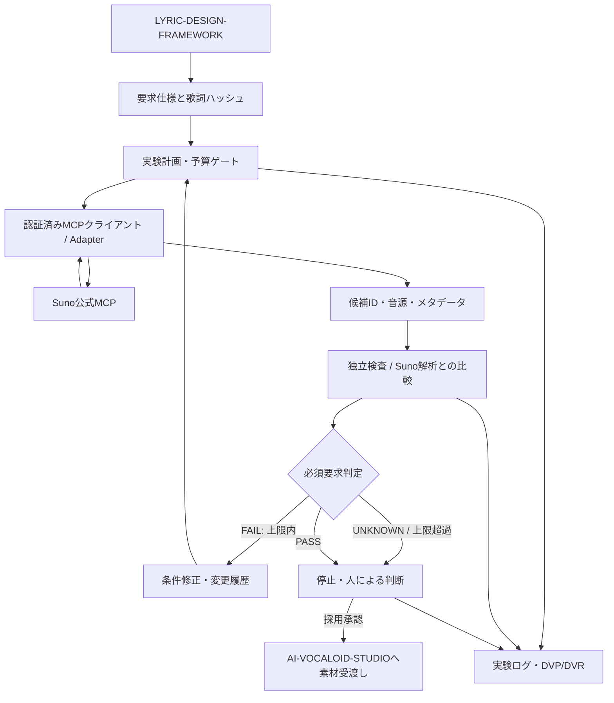

# SUNO-GENERATION-OPTIMIZER — システム要件定義書

| 項目 | 内容 |
|---|---|
| 文書ID | SGO-SRS-001 |
| 版 | 0.1.0 |
| 作成日 | 2026-11-25 JST |
| 管理 | Gacky-Lab |
| 状態 | 要件ベースライン案 / 実装・認証済みSuno接続・実測は未実施 |
| 対象 | 個人の正規Sunoアカウントを用いた生成音楽の要求適合性検証・閉ループ最適化 |
| 規範 | MUST＝必須、SHOULD＝推奨、MAY＝拡張。P0＝オフライン、P1＝最小実機、P2＝閉ループ、P3＝研究拡張 |

> **現況への案内（2026-11-26 JST）:** 上表は設計時のベースラインであり、現在の実装状態ではない。認証・生成・P1音源測定およびP2探索的比較の実施範囲は [README](../README.md) と [P2 repeated DVR](P2_REPLICATED_DVR.md) を参照。試した介入の優位性・無人有料ループ・ユーザー価値は未実証。
> Historical baseline retained. See the current README and DVR for the evidence boundary. [Portfolio traceability](https://github.com/Gacky-Lab/Gacky-Lab/blob/main/docs/governance/RESEARCH_TRACEABILITY.md).

## 1. 背景・目的

生成音楽では同じ入力でも出力が変動し、BPM、歌詞、曲長、編成などの指定が保証されない。生成を繰り返すだけでは、どの条件が改善に寄与したか、費用対効果が高かったかを説明しにくい。

本システムは、楽曲要求を機械可読な仕様にし、公式Suno MCPによる生成、独立した音響検査、判定、制約付き条件修正、再生成を接続する。製造業の要求管理、DVP（設計検証計画）、DVR（検証結果報告）、品質ゲートを生成音楽へ応用する。作者の感性や最終選曲を代替せず、要求への適合と創作上の好みを分離する。

**研究仮説 H1:** 予算を揃えた固定プロンプト再生成より、検査結果をフィードバックする条件修正のほうが必須要求適合率を改善する。
**H2:** 音響測定・歌詞照合を組み合わせると、人の確認負担を減らせる。
**H3:** モデル・ツール仕様・入力・費用・結果を追跡することで、実験条件の再実行と結果監査が可能になる。
いずれも仮説であり、優位性・世界初・ヒット予測・同一音源の再生成を主張しない。

### 1.1 利用者・成功条件

- 作者：歌詞と要求を設定し、支出上限を承認し、採用候補を聴取・承認する。
- 開発者：Gitで仕様・コード・テスト・安全な研究結果を管理する。
- 研究者：条件を固定した対照実験と測定精度を確認する（同一人物でもよい）。
- P1成功：正規認証で少なくとも1回の生成を追跡し、許可された音源を取得または手動保存し、BPM/曲長等の検査結果を記録する。
- P2成功：必須要求が不合格のケースから少なくとも1回の承認済み再生成を行い、予算・終了条件・証跡を検証する。品質向上そのものは別途統計検証する。

## 2. スコープと境界

| 対象 | 初期範囲 | 非対象・拡張 |
|---|---|---|
| 入力 | 自作歌詞、テキストの楽曲指示、目標BPM・曲長・予算 | MIDI制御・参考音源はP3 |
| 生成 | 正規MCP、1人のアカウント、直列実行 | 非公開REST API、スクレイピング、認証回避、複数アカウントによる制限回避は禁止 |
| 評価 | 独立した音響指標、歌詞照合の補助、人による確認 | ヒット率予測、著作権侵害の自動断定、感性の絶対採点は対象外 |
| 最適化 | ルールベースの有限回フィードバック、同条件ベースライン | 学習型探索はP3。Sunoのモデル学習・抽出・競合モデル構築は対象外 |
| 出力 | 承認候補、検査報告、素材マニフェスト | 配信・公開・削除・課金プラン変更は自動化しない |
| 接続先 | LYRIC-DESIGN-FRAMEWORK / AI-VOCALOID-STUDIO | VOCALOID6やDAWによる制作実行自体は既存プロジェクト側 |

Sunoの利用規約・追加条件・契約プラン・レート制限の範囲内で、自作・許諾済み素材の小規模な制作検証を行う。無人連続生成、大量収集、独自の汎用MCPクライアント運用は許可条件の確認が前提。条件が不明なら公式対応クライアント内で都度承認する運用に限定する。

## 3. 外部インターフェースの根拠

2026-11-25時点の公開資料確認。公式の機能説明は、個別ツール名・引数・戻り値・権限の実機確認とは区別する。

| ID | 能力 | 公開根拠 | 実装上の条件 |
|---|---|---|---|
| IF-01 | MCP接続・アカウント認可 | S1/S2/S3 | https://api.suno.com/mcp、対応クライアントでユーザーが認可 |
| IF-02 | テキスト・歌詞から生成 | S1/S2 | 生成ツールの実スキーマ、返却ID、出力数を確認 |
| IF-03 | 状態待ち・曲情報取得 | S2/S8/S9 | 第三者報告の候補名。認証後に存在・状態値・上限を確認 |
| IF-04 | テンポ、キー、楽器、歌詞タイミング解析 | S2 | 結果の型、単位、誤差、費用を確認 |
| IF-05 | 音源取得 | S8/S9、S1 | 直接取得の権限・形式は未確認。正規手動保存を代替手段とする |
| IF-06 | 利用可能クレジット | S1/S2/S4 | 残高・費用取得方法、反映遅延、上限を確認 |
| IF-07 | Cover、Extend、部分編集 | S2 | P3。編集前後の対応付け、変更対象外保持性を検証 |
| IF-08 | ステム、MIDI入出力 | S2 | P3。MIDIの入力先、トラック意味、権限、形式を確認 |
| IF-09 | モデル、Seed、数値BPM等の直接指定 | 未確認 | 使用可能と仮定しない。テキスト指示と保証値を区別 |

S8/S9の第三者記録にある候補名（audio-create、audio-wait、audio-retrieve、audio-analysis、account-usage、audio-download等）は探索用であり、公式契約として固定しない。

### 3.1 MCP契約管理

- 初回はクライアントの認可フローを利用し、対応するMCPプロトコルをネゴシエートする。tools/listの全ページを取得し、能力・ツール名・inputSchema・利用可能なoutputSchemaを確認する。クライアントが生の一覧を出せない場合は確認可能な範囲を記録し、未確認能力を無効にする。
- 取得日時、プロトコル版、クライアント版、サーバー版（提供される場合）、契約プランの区分、正規化スキーマのSHA-256をローカル記録する。認証ヘッダー・URLの秘密部分・アカウントIDは公開しない。
- 生成等の操作は能力マッピングと入力検証を通す。未知ツール、未知の必須引数、スキーマ変更、未解釈の応答は停止して再承認する。
- tools/callのJSON-RPCエラーとツール結果のisErrorを区別する。構造化応答とテキスト応答を区別し、曖昧な文字列から成功を推測しない。応答は非信頼データとして扱う。
- 公式対応クライアントからの承認付き手動呼出をP1の最低実装とする。Pythonから直接認証する方式は公式の許容条件・認証・接続試験を満たした場合だけP2で採用する。

## 4. 論理アーキテクチャ



GitHubはコード・要求・試験・公開可能な証跡の保管場所であり、認証済みMCP実行基盤ではない。推奨環境はWindows 11、VS Code、Python 3.11以上、公式対応MCPクライアント（例：Claude Code/Cursor）。Pythonは判定・実験制御・報告に責任を持つ。外部AIアシスタントが任意の実行や条件変更を行わないよう、入出力契約と承認で境界を設ける。

## 5. 機能要件（要求IDは変更時も維持）

| ID | 優先 | MUST要件 | 受入ID |
|---|---|---|---|
| FR-01 | P0 | 要求JSONの版・型・必須値・範囲・矛盾・予算を生成前に検証する | T01 |
| FR-02 | P0 | Lyric Handoff v1の原文・版・SHA-256を検証し、作者の承認なしに歌詞を変えない | T02 |
| FR-03 | P0 | 原文と要求から生成指示を組み立て、実際に送信した指示と差分を記録する | T03 |
| FR-04 | P1 | MCPを認可し、能力を列挙して確認済みスキーマだけを使用する | T04 |
| FR-05 | P1 | 送信前に予定操作、見込み費用、入力素材を表示し承認を取得する | T05 |
| FR-06 | P1 | 生成要求と全返却候補IDを関連付け、複数出力・非同期完了を扱う | T06 |
| FR-07 | P1 | 正規手段で素材を取得し、形式・サイズ・SHA-256を検査する。手動取得も記録する | T07 |
| FR-08 | P0 | 独立した音響検査で曲長、BPM推定、クリッピング等を測定し、測定不能を区別する | T08 |
| FR-09 | P1 | Suno解析が利用可能なら別測定値として保存し、独立検査の代用としない | T09 |
| FR-10 | P2 | 歌詞認識・正規化・整列を補助し、誤読・脱落・信頼不足は人に確認させる | T10 |
| FR-11 | P0 | 各要求をPASS/FAIL/UNKNOWN/NOT_APPLICABLEで判定し、必須UNKNOWNは自動合格させない | T11 |
| FR-12 | P2 | 不合格の理由から変更候補を作り、原則1因子ずつ修正し、承認された範囲のみ再生成する | T12 |
| FR-13 | P0 | 最大呼出数・候補数・クレジット・経過時間を制限し、見込み費用不明時は停止する | T13 |
| FR-14 | P0 | 全候補と失敗を記録し、比較可能なJSON・CSV・Markdown/HTML報告を作成する | T14 |
| FR-15 | P1 | 採用候補を人が聴取・承認し、既存制作基盤向けに素材マニフェストを作る | T15 |
| FR-16 | P0 | 再開時に既存ジョブを照会し、結果不明の生成要求を自動再送しない | T16 |
| FR-17 | P2 | 同一予算の固定指示ベースラインと適応型条件修正を比較できる実験モードを備える | T17 |
| FR-18 | P3 | MIDI、ステム、Cover/Extend/編集の能力に応じ、保持率・差分検査を追加できる | T18 |

### 5.1 ユースケース

UC-01 オフライン：架空歌詞と合成テスト音源を用意 → 要求読込 → 模擬応答 → 検査 → 判定 → 報告。ネットワークと課金なし。
UC-02 実機：作者がSunoを認可 → 能力確認 → 予算・送信内容承認 → 1回生成 → 全候補の完了確認 → 正規取得 → 検査・聴取 → 記録。
UC-03 最適化：不合格理由を特定 → 変更前後の指示を表示 → 上限を再確認 → 承認 → 再生成 → 比較。全要求PASSでも自動公開しない。
UC-04 異常：認証失効、タイムアウト、クレジット不足、仕様変更、取得不能 → 停止・原因・再開位置を記録。曖昧な生成結果は既存ジョブ照会後にのみ再判断。

## 6. 楽曲要求・測定・判定

次の数値は**初期試験用の暫定例であり、Suno API引数、推奨楽曲品質、実測結果ではない**。作者が変更できる。

| ID | 要求例 | 測定・判定 | 初期優先 |
|---|---|---|---|
| R-01 | 140 BPM ±5 | 独立テンポ推定、半テンポ/倍テンポ候補を表示。不確実ならUNKNOWN。合成クリックで精度検証 | 必須例 |
| R-02 | 180秒 ±20秒 | デコード後のサンプル数÷サンプルレート。160〜200秒はPASS | 必須例 |
| R-03 | 原文の歌詞を保持 | 原文SHAは入力検査のみ。歌唱の文字誤り率CER、脱落、読みを別測定。ASR誤りは人が確認 | 必須例 |
| R-04 | イントロ10秒以内 | 初回有意な歌唱開始時刻。ASR・ボーカル分離・人のアノテーション。境界誤差も記録 | 任意 |
| R-05 | ギター・シンセを含む | 音響タグ・Suno解析・聴取。分類器の不確実性を記録 | 任意 |
| R-06 | 波形の過大ピークなし | full-scale近傍サンプル連続数などの閾値とPCM形式を明記。元音源の歪み不在は保証しない | 任意 |
| R-07 | ラウドネス範囲 | FFmpeg等のEBU R128に沿った統合LUFS測定。配信用目標値は別設定 | 任意 |
| R-08 | ジャンル・感情・歌声の意図 | 作者のブラインド聴取・基準に沿った主観評価。自動分類は参考 | 任意 |

歌詞CER＝(置換＋削除＋挿入)/参照文字数。挿入によって1を超える場合を保持。漢字読み、モーラ、促音、長音、日英混在は文字一致率のみで合格としない。正規化規則は版管理し、原文・正規化文・認識文を区別する。無音、空参照、測定失敗はUNKNOWNまたは非適用（仕様で許可された場合のみ）。

判定規則：
- 全必須要求PASSかつ人の採用承認があれば受渡し可能。任意項目の高得点で必須FAILを相殺しない。
- 必須FAILなら不合格、FAILなしで必須UNKNOWNなら保留。必須NOT_APPLICABLEを許可しない。
- 任意評価の重み付きスコアは評価可能項目の割合と併記。欠損をゼロ点または満点とみなさない。
- 試行数は生成呼出数と候補曲数を別に数える。Suno解析と独立計測が同じでも独立した正解ラベルとは限らない。

## 7. 制御・予算・状態遷移

状態：DRAFT → VALIDATED → APPROVAL_REQUIRED → SUBMITTED → WAITING → ACQUIRED → EVALUATED → ACCEPTED / REVISE / REVIEW_REQUIRED / STOPPED。
通信結果不明は SUBMISSION_UNKNOWN として独立管理する。受理済みIDの照会以外の書込操作を停止し、作者が解消するまで新規生成しない。

- P1初回は最大1生成呼出。P2初期例は最大3生成呼出、最大6候補（実際の出力数・上限保証を確認）、予算はユーザーが明示承認したクレジット数、時間は30分を暫定上限とする。未設定の予算で実機実行しない。
- クレジット残高と1操作の安全な上限費用を取得または確認し、予約額＋既消費額＋次操作上限が承認予算を超える場合は呼出禁止。生成以外の有料処理も含める。外部サービスの費用仕様が不明、他端末での消費・反映遅延がある場合は厳密な上限保証ができないため、都度確認し停止する。
- 認証失効、429、5xx、接続断は読み取りのみ指数バックオフ（上限・Retry-After尊重）。課金や生成を伴う呼出は自動再送しない。取消機能の存在や返金を仮定しない。
- 変更案は固定ルール（例：BPM不一致→テンポ指示の明確化）から開始。必須歌詞の書換え禁止。探索履歴、変更理由、改善/悪化を保存。
- 終了条件：全必須PASS、予算/回数/時間上限、改善なし（初期例2回）、能力変更、費用不明、ユーザー停止、通信不明、人の確認が必要な場合。停止時は未確定ジョブを明示する。

## 8. データ契約（内部仕様案、公式Sunoスキーマではない）

```json
{
  "contract_version": "0.1.0",
  "experiment_id": "demo-001",
  "song_id": "fictional-song",
  "lyric_handoff_path": "inputs/handoff.json",
  "style_prompt": "Japanese electronic rock",
  "requirements": [
    {"id":"R-01","metric":"tempo_bpm","target":140,"tolerance":5,"mandatory":true},
    {"id":"R-02","metric":"duration_seconds","min":160,"max":200,"mandatory":true}
  ],
  "limits": {
    "max_generation_calls": 3,
    "max_candidates": 6,
    "max_credits": null,
    "max_elapsed_seconds": 1800
  },
  "mode": "offline"
}
```

max_credits=nullはオフライン専用。実機では承認済みの非負整数に置換し、生成が有料なら正の予算を要求する。型・範囲・一意ID・パストラバーサル拒否・相互制約をJSON Schemaと追加検証で扱う。

| 成果物 | 必須内容 |
|---|---|
| requirements.json | 版、要求ID、閾値、必須性、入力参照、予算、モード |
| capability_snapshot.json | 取得日時、公開可能な能力・スキーマハッシュ、確認レベル |
| experiment.json | run_id、コードcommit、依存版、OS、モデル識別子（不明ならnull）、条件・seed（利用可能時のみ）、開始終了時刻 |
| attempts.jsonl | attempt_id、送信指示版、候補ID（非公開）、状態、費用、変更理由、エラー |
| metrics.json | 候補ID、要求ID、測定値、単位、方法版、信頼度/不確実性、証拠参照、判定、理由 |
| report.md / report.csv | DVP要求とDVR実測の対応、全候補、欠測、支出、結論と限界 |
| handoff_manifest.json | 承認記録、素材の相対パス・種類・SHA-256、歌詞版・参照、測定結果、生成条件参照 |

状態は明示的に保存し、更新は原子的に行う。日時はISO 8601 UTCを基本とし、表示時のみJST等に変換。秘密情報・実アカウントID・署名付きURL・未公開歌詞/音源はローカル専用。公開データは架空または権利確認済みの匿名化データのみ。

## 9. 既存リポジトリとの統合要件

### 上流：LYRIC-DESIGN-FRAMEWORK
- 現行 [Lyric Handoff v1](https://github.com/Gacky-Lab/LYRIC-DESIGN-FRAMEWORK/blob/main/docs/handoff_interface.md) を取り込む。
- contract_version 1.0.0、song_id、lyric_version_id、language、lyrics_text、lyrics_sha256、任意editorial_assessmentを既存schemaに沿って検証。改行LF正規化後のUTF-8本文をハッシュ照合し、空白・最終改行を勝手に変更しない。
- 参照スキーマと互換テストのコミットを実装時に固定する。採点は編集上の仮評価であり、歌唱適合結果と混ぜない。改善提案は別データとして返し、作者が採用した場合のみ新版を受け取る。

### 下流：AI-VOCALOID-STUDIO
- [現行外部IF監査](https://github.com/Gacky-Lab/AI-VOCALOID-STUDIO/blob/main/docs/INTERFACES_VERIFIED_2026-11-24.md) に沿う。
- 採用済み音源、取得可能なステム/SMF、元歌詞Handoff、素材ハッシュを受渡し候補とする。ステム/MIDI未取得は明示し、必須素材不足なら受渡し保留。
- handoff_manifestは新規の提案契約。下流側の既存インポータが対応済みとは主張しない。MIDI音符候補はモーラ未整列であり、完成したSong IRではない。
- P1は手動保存・既存処理への入力で境界を検証。自動受渡しは双方のschemaとテストを合意後に実装する。既存2リポジトリの変更は本要件作成の範囲外。

## 10. 非機能要件

| ID | MUST要件 | 検証 |
|---|---|---|
| NFR-01 | デフォルトはoffline/dry-run。CIは実アカウントや課金を使用しない | T19 |
| NFR-02 | トークン・Cookie・秘密URLは認証クライアント/安全なローカル保管のみ。ログ赤字化、秘密検出、公開前レビュー | T20 |
| NFR-03 | モック・解析ロジック・判定は固定入力と固定依存版で再現可能。Suno出力の決定性は保証しない | T19 |
| NFR-04 | 生成ID、条件、費用、失敗・欠測を追跡可能。実測/モック/仮定を報告で区別 | T14 |
| NFR-05 | HTTPS正規接続、許可されたURL/リダイレクト先・サイズ・形式検証。ファイルは安全な作業ディレクトリに保存 | T07/T20 |
| NFR-06 | 公式対応クライアント、Python、音響依存のバージョンを記録。仕様変更は停止・再確認 | T04 |
| NFR-07 | 権利・規約・プランを確認し、生成物の配布権利を個別判断。公開、削除、プラン変更は自動実行禁止 | T05/T20 |
| NFR-08 | 指示・応答・歌詞はデータ扱い。プロンプト注入で外部命令、秘密取得、別ツール起動を行わない | T20 |
| NFR-09 | 初期運用は直列。時間/リソース上限を設定し、停止・再開・一時ファイル整理が可能 | T13/T16 |
| NFR-10 | 検査方法、閾値、変更履歴、既知の誤検出を日英概要と日本語詳細で記録 | T14/T19 |

## 11. DVP / DVR 受入試験

初期は全てNOT_RUN。期待結果は合格実績ではない。モック成功と実機成功を分離する。

| ID | レベル | 試験・合格基準 |
|---|---|---|
| T01 | offline | 正常要求を受理。不正型、重複ID、範囲逆転、予算未指定liveを全て拒否 |
| T02 | offline | 既存Handoffの正常・CRLF・本文改ざん例。仕様どおりのSHA一致/不一致 |
| T03 | offline | 原文を維持し、同一入力で同一生成指示。条件変更は差分で追跡 |
| T04 | live read-only | 正規認可、能力一覧・スキーマ記録。欠落/変更時は生成しない |
| T05 | live controlled | 承認拒否または費用不明で生成呼出0。承認内容と送信値が一致 |
| T06 | live controlled | 1回の許可済み生成、全候補ID・状態・費用を追跡。結果不明時は停止 |
| T07 | offline/live | 正規取得または手動素材取込。実ファイルのハッシュ照合、異常パス/形式/サイズを拒否 |
| T08 | offline | 合成120/140 BPMクリックを±2 BPM（半倍テンポは区別）、既知長を±0.1秒で測定。無音はBPM UNKNOWN |
| T09 | live controlled | Suno解析が利用可能なら取得値と独立計測を別欄に記録。差異や未取得を隠さない |
| T10 | offline + human | 自作短文の正常、欠落、置換、挿入例でCER計算一致。実歌唱認識精度は別途人手正解で測定 |
| T11 | offline | 必須FAIL・UNKNOWN・全PASS等の判定表を全網羅。任意高得点による相殺なし |
| T12 | mock/live | 既知の不合格から承認付き条件修正を1回以上。入力歌詞保持、差分、予算、停止条件を確認 |
| T13 | offline | 上限到達、費用不明、クレジット不足、時間超過の全ケースで追加有料呼出0 |
| T14 | offline | 全候補・失敗・未測定をJSON/CSV/報告で追跡し、要求ID・証跡が対応 |
| T15 | manual integration | 承認済み素材のハッシュと歌詞版を照合。下流へ手動入力できる形式を確認（歌声合成成功とは別） |
| T16 | offline | 通信断直後の再開、重複応答、認証失効で生成の二重送信0 |
| T17 | research | 同一予算・停止条件でA/B比較。全試行の費用、合格率、欠測、差の不確実性を報告 |
| T18 | optional live | 各能力を個別に確認後、MIDI保持率・編集差分等の検証方法を追加 |
| T19 | CI | ネットワークなしの単体・統合・契約試験が全件合格。Suno呼出0 |
| T20 | security | 偽応答、秘密URL、悪意あるパス・指示を用いた試験で秘密漏えい・未承認操作0 |

DVRの必須列：test_id、対応要求、実行モード、実行日時、環境/commit、入力fixture、期待値、実測値、証跡、PASS/FAIL/BLOCKED/NOT_RUN、担当・所見。
受入ゲート：P0の必須offline試験を全合格 → P1のT04/T05を先行確認 → 承認済み生成T06/T07/T09 → P2の閉ループ検証。未対応の任意能力はBLOCKEDで記録し、必須ゲートを省略しない。

## 12. 研究計画・評価指標

A群：同じ初期指示を繰り返す。B群：同じ初期指示から不合格理由に応じて修正する。自作の複数歌詞と要求セットを用い、モデル（指定可能時）・時期・初期条件・許可費用・終了条件を揃え、実行順を交互または無作為にする。最初は少数のパイロットで測定可否と費用を確認し、その結果から必要試行数を設計する。多数の生成を初期必須にしない。

| 指標 | 定義 |
|---|---|
| 必須適合率 | 全必須PASS候補数 / 全候補数。UNKNOWN・失敗は除外せず別掲 |
| run成功率 | 予算内に必須PASSへ到達したrun / 開始run |
| 最初の合格までの費用 | 合格到達までの観測クレジット。未達runは打切りとして記録 |
| 適合曲当たり費用 | 消費クレジット総額 / 合格候補数（0件は未定義） |
| BPM絶対誤差 | abs(測定BPM - 目標BPM)。不確実測定の件数も報告 |
| 人手確認負担 | 候補当たり確認時間、確認件数、誤検出/見逃し率（人手ラベルを参照） |
| 安定性 | 同条件での分布、モデル/仕様の版による層別 |

Bの勝利は事前に定めた主要評価指標で判断する。改善幅と信頼区間を示し、同一runからの複数曲を独立サンプルとみなさない。盲検聴取は順序の影響を抑える。好みの評価と機械的要求適合は別の結論とする。研究データは権利・規約上許容される範囲でのみ公開する。

## 13. 開発段階と予定成果物

| 段階 | 成果物（今後の実装候補） | 完了条件 |
|---|---|---|
| P0 | schemas、offline CLI、mock adapter、合成WAV fixture、判定・予算・ログ、pytest/CI | T01–03,08,11,13,14,16,19,20のoffline部分 |
| P1 | MCP能力確認手順、実機操作アダプタまたは承認付き手動橋渡し、DVR、素材受渡し | T04–07,09,15の適用項目。最低1回生成 |
| P2 | 条件修正ポリシー、歌詞検査補助、予算付き反復実験、比較報告 | T10,12,17 |
| P3 | MIDI制御性、編集差分、ステム品質、モデル変動、探索アルゴリズム | T18と個別研究要件 |

予定ディレクトリ：docs/、schemas/、src/suno_optimizer/、tests/、examples/（架空データのみ）、fixtures/、.github/workflows/。実行ログ・音源・認証関連はGit管理外のローカルディレクトリに保存する。現時点では本要件定義の登録であり、これらの実装済みを意味しない。

## 14. リスク・未決事項

| ID | リスク/未決 | 対応と解決ゲート |
|---|---|---|
| O-01 | アカウント別の実MCPスキーマ・取得権限・費用未確認 | P1冒頭で認可・tools/list・契約確認。実機未接続のまま固定しない |
| O-02 | 無人自動実行の許容条件、独自クライアントの可否 | 公式資料/規約・必要なら提供元確認。未確認なら都度承認の公式クライアント |
| O-03 | クレジット・出力数・費用確定タイミングが不明 | 上限不明なら停止。作者が実機予算を決める |
| O-04 | 日本語歌唱認識・テンポ・楽器推定の誤差 | 合成/人手ラベルで検証。UNKNOWNと手動確認 |
| O-05 | Seedやモデル選択の不在、バックエンド更新 | 条件ログ、対照実験の同時期実行、版不明を明記 |
| O-06 | 上下流の新規マニフェスト合意未済 | P1で既存IFを検証。下流への自動統合は別変更 |
| O-07 | 公開Gitに秘密・未公開音源が混入 | deny-by-default、公開前レビュー、権利台帳、漏えい時の認証失効 |
| O-08 | 要求適合が創作価値を損なう | 主観評価を別軸にし、人が採用/却下可能 |

## 15. 参照資料（2026-11-25確認）

- S1 [Suno MCP公式ページ](https://suno.com/mcp)
- S2 [What is Suno MCP? — 2026-11-18更新](https://help.suno.com/en/articles/14551361)
- S3 [公式接続手順 — 2026-11-18更新](https://help.suno.com/en/articles/14551425)
- S4 [Suno MCP FAQ — 2026-11-18更新](https://help.suno.com/en/articles/14486145)
- S5 [Suno Terms of Service](https://suno.com/terms)（表示上2026-09-03発効。利用時に再確認）
- S6 [MCP tools specification 2025-11-25](https://modelcontextprotocol.io/specification/2025-11-25/server/tools)
- S7 [Suno MCP beta release note](https://suno.com/release-notes/suno-mcp-beta)
- S8 [第三者のツール観測記録: ai-music-maker](https://github.com/WillMakes/ai-music-maker/blob/main/docs/suno-mcp.md)
- S9 [第三者のMCPマッピング: claude-ai-music-skills](https://github.com/bitwize-music-studio/claude-ai-music-skills/blob/main/reference/suno/mcp-api-mapping.md)
- S10 [LYRIC-DESIGN-FRAMEWORK: Handoff](https://github.com/Gacky-Lab/LYRIC-DESIGN-FRAMEWORK/blob/main/docs/handoff_interface.md)
- S11 [AI-VOCALOID-STUDIO: 外部IF監査](https://github.com/Gacky-Lab/AI-VOCALOID-STUDIO/blob/main/docs/INTERFACES_VERIFIED_2026-11-24.md)

S8/S9は補助資料で公式仕様・本プロジェクトの接続実績ではない。実装時には対象アカウントの能力と資料の版を再確認する。本プロジェクトはSuno等の公式製品・提携プロジェクトではない。既存のライセンス設定を変更しない。
